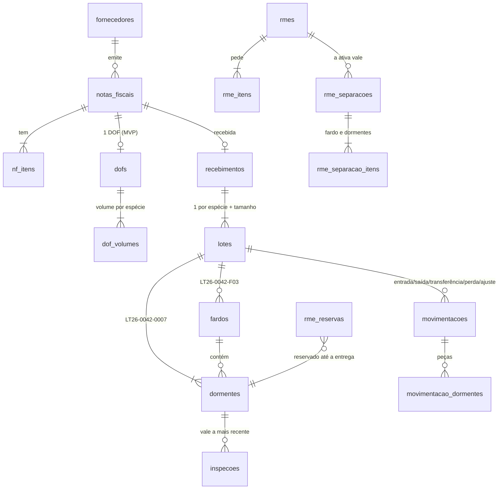

# Banco de dados no Supabase

Banco PostgreSQL no Supabase que o front usa direto pela implementação `src/services/supabase/`
(a terceira da interface `Servicos`, ao lado de `mock/` e `real/`). As regras de negócio são as
mesmas de `src/services/mock` e valem no banco: o front esconder botões é só UX.

| Arquivo | Conteúdo |
|---|---|
| `supabase/migrations/20261107000001_esquema.sql` | tipos, tabelas, restrições e índices |
| `supabase/migrations/20261107000002_regras.sql` | gatilhos e as funções que gravam (uma por operação de `Servicos`) |
| `supabase/migrations/20261107000003_views.sql` | views `v_*` no formato de `src/types/models.ts` e funções de leitura |
| `supabase/migrations/20261107000004_seguranca.sql` | RLS, privilégios e buckets do Storage |
| `supabase/seed.sql` | permissões, papéis, parâmetros, espécies, tamanhos, endereços do pátio |
| `supabase/reset.sql` | apaga o schema `public` para recomeçar (os usuários do Auth ficam) |

## Como aplicar

No painel do projeto, **SQL Editor → New query**, cole e rode **um arquivo por vez, nesta ordem**:

1. Só se já houver uma versão anterior do banco: `supabase/reset.sql`.
2. `migrations/…0001_esquema.sql`, `…0002_regras.sql`, `…0003_views.sql`, `…0004_seguranca.sql`.
3. `supabase/seed.sql`.

Cada um deve terminar com "Success. No rows returned". Com a CLI (`supabase link` e
`supabase db push --remote`) o resultado é o mesmo; não misture os dois caminhos.

### Usuários

Crie cada pessoa em **Authentication → Users → Add user** (e-mail e senha, "Auto Confirm User").
O perfil é criado sozinho; o papel é dado no SQL Editor:

```sql
insert into usuario_papeis (usuario_id, papel)
select id, 'administrador' from perfis where email = 'fulano@exemplo.com';
```

Papéis do seed: `administrador`, `almoxarife`, `operador`, `supervisor`, `requisitante`, `gestor`
(as mesmas permissões dos perfis de demonstração do mock). Para desativar alguém:
`update perfis set ativo = false where email = '...'`.

### Front

No `.env.local`:

```
VITE_USE_MOCK=false
VITE_SUPABASE_URL=https://<id-do-projeto>.supabase.co
VITE_SUPABASE_ANON_KEY=<chave "anon public">
```

Os dois valores ficam em **Project Settings → API**. A chave `anon` é pública por definição (quem
protege os dados é a RLS); a `service_role` e a senha do banco nunca vão para o `.env`.
Reinicie o `npm run dev`. O login é pelo e-mail; a sessão fica só em memória (recarregar a página
pede login de novo, como no resto do app).

### Testar com uma pessoa só

A conferência da RME exige que quem confere não seja quem separou. Para testar sozinho:
`update parametros set valor = 1 where chave = 'permitir_conferente_igual_separador';`
(volte para 0 em produção). Perda e ajuste não podem ser decididos por quem registrou: use dois usuários.

## Como o front lê e grava

- **Listas:** `GET /rest/v1/v_<nome>` com `busca=ilike.*termo*` (coluna `busca`), filtros por igualdade
  (`status=eq.aberta`), `order=campo.dir,…,id.asc` e `limit/offset` com `Prefer: count=exact`
  (o total vem no `Content-Range`). As colunas das views já têm os nomes do modelo.
- **Ações:** `POST /rest/v1/rpc/<função>` com argumentos nomeados. Erro de regra vem com o status HTTP
  certo (SQLSTATE `PT<status>`) e o campo no `hint` (`campo:<nome>`), como `ApiError.detalhes`.
- **Arquivos:** enviados ao Storage na pasta do usuário (`<uid>/...`) e registrados por `registrar_arquivo`.
  Buckets privados: `nfe-xml`, `dof-pdf`, `recebimento-fotos`, `visao-imagens`.

| Serviço (`contracts.ts`) | Leitura | Gravação (função) |
|---|---|---|
| `auth` | `meu_usuario()` | Supabase Auth (`/auth/v1/token`) |
| `dashboard` | `ui_indicadores()`, `ui_alertas()`, `ui_pendencias()` | — |
| `fornecedores`, `documentos` | `v_fornecedores`, `v_documentos` | (fornecedor entra pelo SQL; não há tela) |
| `notas` | `v_notas` | `nf_cadastrar`, `nf_cadastrar_dof`, `nf_declarar_dof` |
| `recebimentos` | `v_recebimentos` | `recebimento_confirmar` |
| `lotes` | `v_lotes`, `lote_obter()`, `lote_sugestao_fardos()` | `lote_formar_fardos` |
| `inspecoes` | `v_inspecoes` | `inspecao_lancar`; Inspector: `inspecao_do_inspector` (service role) |
| `fardos`, `estoque`, `dormentes` | `v_fardos`, `fardo_obter()`, `v_saldos`, `v_dormentes` | — |
| `movimentacoes` | `v_movimentacoes` | `mov_registrar`, `mov_decidir` |
| `rme` | `v_rmes`, `rme_opcoes()` | `rme_abrir`, `rme_separar`, `rme_conferir`, `rme_entregar`, `rme_cancelar` |
| `inventario` | `v_sessoes_inventario`, `v_divergencias_inventario` | `inventario_criar`, `inventario_contagem` |
| `visao` | `v_processamentos` | `visao_enviar` |
| `patio` | `v_locais_patio`, `v_transferencias` | — |
| `relatorios` | `v_relatorios`, `rel_saldo_ibama()`, `rel_dofs_pendentes()`, `rel_movimentacoes()` | `exportacao_solicitar` |
| `parametros` | `parametros_obter()` | `parametros_atualizar` (admin) |
| `especies`, `tamanhos` | `v_especies`, `v_tamanhos` | `especie_atualizar`, `tamanho_salvar` |
| `auditoria`, `volumetria`, `usuarios` | `v_auditoria` (admin), `v_volumetria`, `v_usuarios` | — |

## Modelo



- Os **dormentes** são criados no recebimento (estado `sem_fardo`), para as inspeções do Inspector
  terem onde se ligar pelo código da peça; na formação dos fardos passam a `em_estoque`. `v_dormentes`
  mostra só os que já estão em fardo, como o modelo `Dormente`.
- O **saldo do fardo** é mantido por gatilho: sempre o número de dormentes em estoque nele.
- **Reserva** de RME é uma linha em `rme_reservas` (um dormente por vez); só a entrega dá baixa.
- **Nada é apagado:** cancelamento, devolução e rejeição viram estado e motivo; `auditoria` guarda
  antes/depois das tabelas principais.

## Pendências

- **Integração com o Inspector:** o servidor (com a chave `service_role`, nunca no front) chama
  `inspecao_do_inspector(codigo_peca, veredito, indice, inspetor, estacao, quando, relatorio_url, id_externo)`
  para cada registro do banco do Inspector (ver `docs/INTEGRACAO-INSPECAO.md`). Idempotente por `id_externo`.
- **Liberar divergência de volume:** não há tela; supervisor/gestor chama
  `recebimento_liberar_divergencia(<id do recebimento>, '<motivo>')`.
- **Fornecedores e endereços do pátio** entram pelo SQL (não há tela de cadastro no contrato).
- Medidas dos tamanhos, classes das espécies e parâmetros seguem provisórios até a CPTM confirmar.
- O Supabase devolve no máximo 1000 linhas por consulta (`FardosModal` pede até 5000 dormentes).
